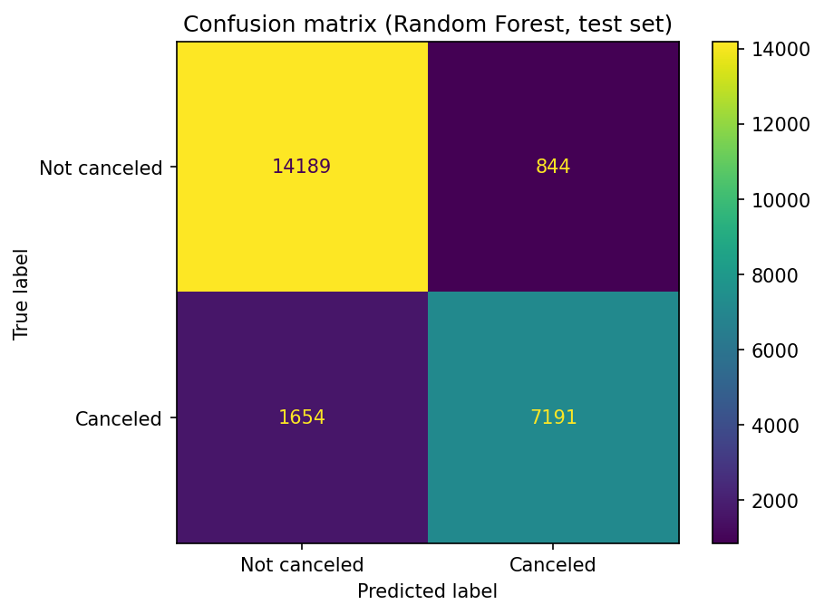
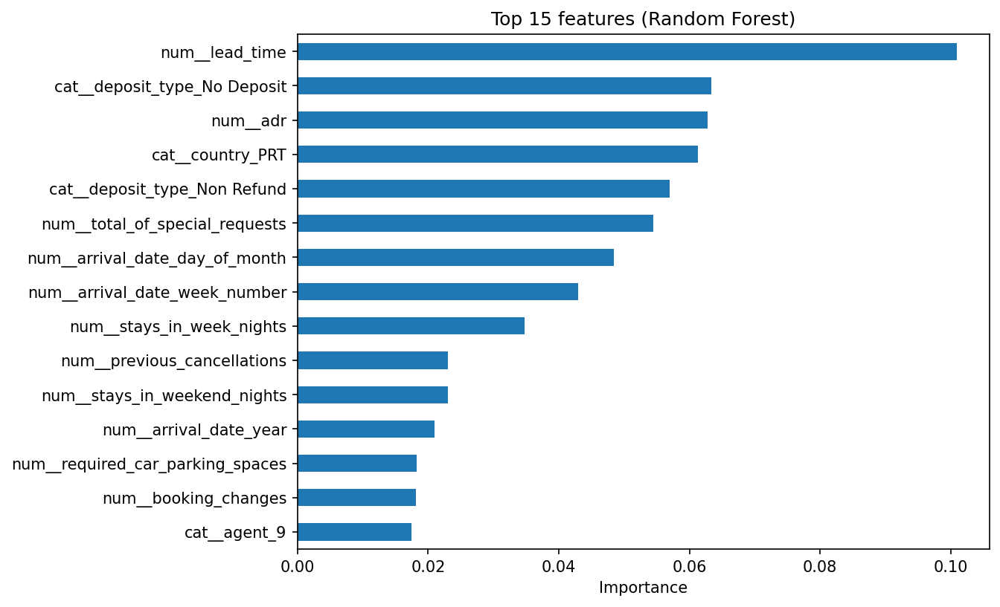

# Hotel Booking Cancellation Prediction

Predicting whether a hotel booking will be canceled, using scikit-learn and XGBoost.
The project includes a data leakage check, a preprocessing Pipeline, model comparison with
5-fold cross-validation, and hyperparameter tuning.

## Dataset
Hotel booking demand dataset (published by Antonio, Almeida and Nunes, 2019):
119,390 bookings from two hotels, 32 columns. 37% of bookings were canceled.
The data file is not included in this repo. It is available on Kaggle ("Hotel booking demand")
and in the TidyTuesday repository (`data/2020/2020-02-11/hotels.csv`).
Save it as `hotel_bookings.csv` next to the notebook.

## Approach
1. **Exploration:** class balance (63% / 37%) and missing values
   (`company` is missing in about 94% of rows, so it was dropped).
2. **Data leakage:** `reservation_status` is the final status of the booking, so it is only
   known after the outcome. A depth-3 decision tree with this single column reached 100%
   accuracy, so it was removed together with `reservation_status_date`.
3. **Preprocessing (Pipeline + ColumnTransformer):** median imputation and scaling for numeric
   columns; constant imputation and one-hot encoding for categorical columns.
4. **Models:** Logistic Regression, Random Forest, XGBoost.
5. **Validation:** stratified 80/20 train/test split, 5-fold cross-validation on the training set.
6. **Tuning:** Grid Search on XGBoost (n_estimators, max_depth).

## Results (test set, 23,878 bookings)
| Model | Accuracy | Precision | Recall | F1 | ROC-AUC |
|---|---|---|---|---|---|
| Logistic Regression | 0.831 | 0.812 | 0.709 | 0.757 | 0.913 |
| Random Forest | 0.895 | 0.895 | 0.813 | 0.852 | 0.959 |
| XGBoost (default) | 0.876 | 0.860 | 0.795 | 0.827 | 0.950 |
| XGBoost (tuned) | - | - | - | 0.832 | 0.953 |

5-fold cross-validation F1: Logistic Regression 0.759, Random Forest 0.846, XGBoost 0.827
(tuned XGBoost: 0.832).




## Key findings
1. A column that reveals the outcome gave 100% accuracy; checking this before modeling avoided a model that would have been useless in practice.
2. Random Forest was the best model in both cross-validation and on the test set. Tuning XGBoost improved it slightly (F1 0.827 to 0.832) but not enough to beat it.
3. The final model finds 81% of cancellations (recall) and 89% of its cancellation predictions are correct (precision), so about 1 in 5 cancellations is still missed.
4. The model relies mostly on lead time, deposit type, and the guest's country. In the full dataset, cancellation rises with lead time (9.6% for bookings made 0-7 days ahead vs 57% for 181+ days). Non-refundable bookings were canceled 99.4% of the time (vs 28.4% with no deposit), and guests from Portugal canceled 56.6% of the time (vs 23.6% for other countries). These are patterns in the data, not proof of causes. Feature importance from a Random Forest can also favor numeric columns, so lower-ranked features such as day of month should not be over-interpreted.

## How to run
```
pip install -r requirements.txt
```
Open `hotel_cancellation.ipynb` in Jupyter or Google Colab and run the cells in order
(in Colab, upload `hotel_bookings.csv` when the dataset cell asks for it).

## Limitations
- The split is random, so bookings from the same period appear in both train and test. A time-based split would be a stricter test.
- Columns like `assigned_room_type` and `booking_changes` may contain information that is only known late; I did not test removing them.
- The Grid Search best values were at the edge of the grid, so a wider search might improve XGBoost.
- One-hot encoding splits the importance of a categorical column (e.g. deposit_type) across several rows; summing them would give a fairer ranking.
- Feature importance shows what the model uses, not what causes cancellations.

## Tools
Python, pandas, scikit-learn, XGBoost, matplotlib, Google Colab.